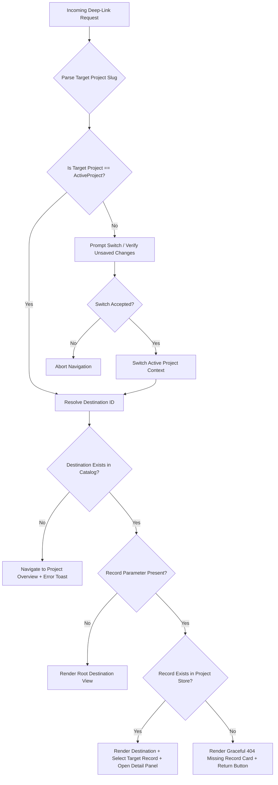

# CONTEXTUAL NAVIGATION AND ACTION CONTRACTS

**Document Identifier:** `NLE-SPC-ACT-001`  
**Phase:** 3 (Desktop Interface & Workspace Management) — Step 21 of 100  
**Status:** Approved Architectural Specification  
**Classification:** Deep-Link Routing, Contextual Entry Points & Action Contracts  
**Parent Document:** `NLE-SPC-WKS-001` ([file:///d:/App%20Winrar%20Files/Nexludic%20Engine%20(working)/docs/ui/PROJECT_WORKSPACE_LAYOUT_AND_NAVIGATION_SPECIFICATION.md](file:///d:/App%20Winrar%20Files/Nexludic%20Engine%20(working)/docs/ui/PROJECT_WORKSPACE_LAYOUT_AND_NAVIGATION_SPECIFICATION.md))  

---

## 1. Contextual Navigation & Deep-Link Resolution Contracts

### 1.1 Deep-Link URI Scheme
NexLudic Engine implements an internal URI routing contract for cross-component navigation and deep links:

```
nexludic://projects/{project_slug}/{destination_id}?record={record_id}&action={action_param}
```

#### URI Examples:
- `nexludic://projects/skyrim-doom-mashup/requirements?record=REQ-002`
- `nexludic://projects/cyberpunk-witcher-bridge/feasibility?record=EVD-CYBER-04`
- `nexludic://projects/skyrim-doom-mashup/ai-tasks?record=TSK-8921&action=diff-review`
- `nexludic://projects/subnautica-outerwilds/diagnostics?record=ERR-IPC-TIMEOUT`

### 1.2 Target Resolution Algorithm



---

## 2. Comprehensive Contextual Action Catalog

| Action ID | Display Label | Purpose | Entry Point | Scope | Preconditions | Permission / Safety | Confirmation Req | Post-Action Behavior |
| :--- | :--- | :--- | :--- | :--- | :--- | :--- | :--- | :--- |
| `ACT-PRJ-001` | Save Project | Commit dirty in-memory state to `project.json` on `D:` | Context Header / `Ctrl+S` | Project | `IsDirty == true` | Standard (Write) | None | Clears dirty bit; updates status tray |
| `ACT-PRJ-002` | Export Package | Archive project into portable `.nxpkg` package | Context Header | Project | Valid manifest; no active file writes | Standard | File Save Picker | Opens export progress dialog; logs to history |
| `ACT-PRJ-003` | Switch Project | Open project selector dropdown/drawer | Context Header / Title Bar | Global | None | Standard | Unsaved changes dialog if dirty | Switches active project context |
| `ACT-REQ-001` | Add Requirement | Open modal form to declare new capability need | Requirements View | Record | Active Project | Standard | None | Appends record to `requirements.json`; sets dirty |
| `ACT-REQ-002` | Delete Requirement | Remove declared capability requirement | Contextual Detail Panel | Record | Requirement exists | Standard | "Delete requirement REQ-XXX?" | Removes record; updates feasibility cache |
| `ACT-FEA-001` | Run Feasibility Audit | Evaluate declared requirements against engine database | Feasibility View | Project | At least 1 requirement | Standard | None | Launches background audit; refreshes matrix |
| `ACT-FEA-002` | Override Assessment | Manually set feasibility score with custom evidence | Feasibility Inspector | Record | Expert Mode enabled | Expert Safety Gate | "Override verified feasibility score?" (Warning) | Logs override citation to `audit.db` |
| `ACT-ADP-001` | Scan Local Adapters | Discover installed game modding hooks on disk | Adapters View | Project | Game paths configured | Standard | None | Refreshes adapter qualification status |
| `ACT-ADP-002` | Bind Adapter | Assign adapter to Game A or Game B runtime | Adapters Grid | Record | Adapter qualified | Standard | None | Updates `project.json`; invalidates testing |
| `ACT-AI-001` | Dispatch AI Task | Queue prompt execution (code/diff/scaffolding) | AI Tasks View | Project | AI API configured | Standard | None | Adds task to queue; status tray reflects run |
| `ACT-AI-002` | Approve Diff | Merge AI-generated staging diff into project mod files | AI Diff Reviewer | Record | Task status == `AWAITING_APPROVAL` | Human-in-Loop Req | "Approve and apply code changes?" | Writes diff to staging; logs audit event |
| `ACT-AI-003` | Reject Diff | Discard AI-generated staging proposal | AI Diff Reviewer | Record | Task status == `AWAITING_APPROVAL` | Standard | Optional feedback text | Discards staging diff; marks task `REJECTED` |
| `ACT-TST-001` | Run Test Suite | Execute automated validation harness | Testing View | Project | Adapters bound | Standard | None | Executes runner; updates pass/fail charts |
| `ACT-ART-001` | Clean Staging Temp | Purge uncommitted staging files in `<project>/staging/` | Artifacts View | Project | No active compilations | Standard | "Purge uncommitted staging cache?" | Deletes staging temp files; re-indexes |
| `ACT-DIA-001` | Snapshot Rollback | Revert project files to last known good snapshot | Diagnostics View | Project | Snapshot exists | Destructive Gate | "Rollback project to snapshot <Date>?" | Restores snapshot; reloads project context |

---

## 3. Destructive Actions & Human-in-the-Loop Approval Invariants

1. **Strict Destructive Gates:**
   - Any action that irreversibly modifies files, discards user edits, or restores previous snapshots (`ACT-REQ-002`, `ACT-ART-001`, `ACT-DIA-001`) requires an explicit modal confirmation dialog with primary destructive action styled in danger red.
2. **AI Execution Approval Gate (`ADR-0009`):**
   - Opening an AI task view or inspecting a generated diff **never** applies the modification automatically.
   - Merging generated code into workspace files requires an explicit click of `ACT-AI-002: Approve Diff`.
3. **No Phantom Recoveries:**
   - If an operation fails, the UI surfaces diagnostics and the option to retry or rollback; it never initiates automatic file rollbacks without explicit user authorization.

