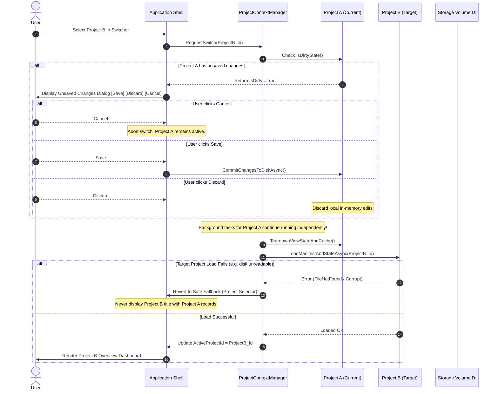

# PROJECT CONTEXT AND NAVIGATION STATE SPECIFICATION

**Document Identifier:** `NLE-SPC-CTX-002`  
**Phase:** 3 (Desktop Interface & Workspace Management) — Step 21 of 100  
**Status:** Approved Architectural Specification  
**Classification:** Navigation State Machine, Context Management & Switching Model  
**Parent Document:** `NLE-SPC-WKS-001` ([file:///d:/App%20Winrar%20Files/Nexludic%20Engine%20(working)/docs/ui/PROJECT_WORKSPACE_LAYOUT_AND_NAVIGATION_SPECIFICATION.md](file:///d:/App%20Winrar%20Files/Nexludic%20Engine%20(working)/docs/ui/PROJECT_WORKSPACE_LAYOUT_AND_NAVIGATION_SPECIFICATION.md))  
**Related Documents:**
- `NLE-SPC-CTX-001`: Project Context & Switching UX Specification ([file:///d:/App%20Winrar%20Files/Nexludic%20Engine%20(working)/docs/ui/PROJECT_CONTEXT_AND_SWITCHING_UX_SPECIFICATION.md](file:///d:/App%20Winrar%20Files/Nexludic%20Engine%20(working)/docs/ui/PROJECT_CONTEXT_AND_SWITCHING_UX_SPECIFICATION.md))
- `NLE-CAT-NAV-001`: Navigation Hierarchy & Destination Catalog ([file:///d:/App%20Winrar%20Files/Nexludic%20Engine%20(working)/docs/ui/NAVIGATION_HIERARCHY_AND_DESTINATION_CATALOG.md](file:///d:/App%20Winrar%20Files/Nexludic%20Engine%20(working)/docs/ui/NAVIGATION_HIERARCHY_AND_DESTINATION_CATALOG.md))

---

## 1. State Hierarchy Model

To guarantee clean data isolation and avoid memory leaks or cross-project data pollution, application state is structured in three strictly decoupled tiers:

```
+----------------------------------------------------------------------------------------------------+
| TIER 1: GLOBAL APPLICATION STATE (Singleton Lifecycle)                                             |
| - Installed Adapters Catalog      - Global Engine Settings         - DPAPI Credential Vault Ref    |
| - Application Theme / Window State - Global Notification Queue      - Active Project Registry       |
+----------------------------------------------------------------------------------------------------+
                                      |
                                      v (Loads / Unloads via IProjectContextManager)
+----------------------------------------------------------------------------------------------------+
| TIER 2: PROJECT-SCOPED STATE (Scoped to ActiveProjectId)                                           |
| - Manifest (project.json)         - Requirements (requirements.json) - Feasibility Matrix (evidence.json)|
| - Candidate Strategy (strategy.json)- Staging Manifest (staging/)  - Unsaved Dirty Bit (IsDirty)   |
| - Active Background Tasks Pool    - Project History SQLite Cache   - Active Navigation History     |
+----------------------------------------------------------------------------------------------------+
                                      |
                                      v (Instantiated per Navigation Destination)
+----------------------------------------------------------------------------------------------------+
| TIER 3: DESTINATION VIEW STATE (Transient / Disposable Lifecycle)                                  |
| - Grid Filter Text                - Selected Item in List / Grid   - ScrollViewer Vertical Offset  |
| - Contextual Detail Panel Open Bit- Form Input Drafts              - Local Search Query            |
+----------------------------------------------------------------------------------------------------+
```

---

## 2. Project Switching Interaction Model & Safety

Switching projects is a critical operation that must guarantee data integrity, prevent silent data loss, and decouple ongoing asynchronous background tasks.

### 2.1 The 5-Step Atomic Switching Lifecycle



### 2.2 Background Operations During Project Switching
- Ongoing background tasks (e.g. AI code generation, adapter compilation, mock IPC testing) run inside project-scoped worker instances tagged with `ProjectId`.
- When switching from Project A to Project B:
  - Project A's tasks are **not terminated**; they continue executing asynchronously.
  - Shell Status Tray displays: *"Running Tasks: 1 task for Project A (Background)"*.
  - When Project A's task completes, a global notification is posted. Clicking it prompts the user to switch back to Project A to inspect results.

### 2.3 Context Cleanup & Anti-Leakage Invariants
- When unmounting a project:
  - All Tier 3 ViewModels are disposed.
  - Selected item references, search filters, and scroll offsets are wiped from memory.
  - No cached UI controls from Project A are reused for Project B.

---

## 3. Navigation History, Back Stack & Breadcrumbs

### 3.1 Back Navigation Semantics
The desktop shell provides a global `Back` command (`Alt+LeftArrow` or Shell Back Button). To prevent ambiguous behavior, Back obeys a strict precedence ladder:
1. **Rule 1 (Inspectors First):** If a Contextual Detail Panel is open, `Back` closes the panel without changing the primary destination.
2. **Rule 2 (Hierarchy Return):** If the user navigated into a sub-record (e.g. `Requirements > REQ-004`), `Back` ascends to the parent destination (`Requirements List`).
3. **Rule 3 (History Stack):** If at a root destination, `Back` pops the previous project-scoped destination from the internal navigation history stack.
4. **Rule 4 (Stack Exhausted):** If the history stack is empty, `Back` routes to the `Project Overview` (`NAV-PRJ-OVR`).

### 3.2 Breadcrumb Architecture
Breadcrumbs in the Main Content Region reflect the **logical domain hierarchy**, not an arbitrary chronological trail of clicks:
```
Pattern: [Active Project Name] > [Parent Functional Area] > [Specific Record / Entity]
Example: "Skyrim-Doom-Mashup" > "Requirements" > "REQ-002: BFG Plasma Injection"
```
Clicking any segment in the breadcrumb navigates directly to that structural ancestor.

### 3.3 Keyboard History & Navigation Shortcuts
- `Alt + Left Arrow`: Navigate Back.
- `Alt + Right Arrow`: Navigate Forward.
- `Ctrl + 1` through `Ctrl + 9`: Direct jump to sidebar destinations 1 through 9.
- `Ctrl + S`: Trigger immediate project save (`FLD-REV-001`).
- `Ctrl + B`: Toggle Contextual Detail Panel.

