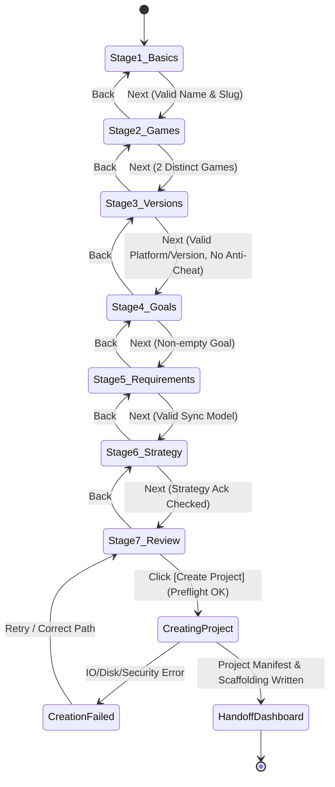

# PROJECT CREATION NAVIGATION AND STATE MODEL

**Document Identifier:** `NLE-SPC-STA-001`  
**Phase:** 3 (Desktop Interface & Workspace Management) — Step 20 of 100  
**Status:** Approved Architectural Specification  
**Classification:** Navigation, State Machine & Concurrency Specification  
**Parent Document:** `NLE-SPC-WIZ-001` ([file:///d:/App%20Winrar%20Files/Nexludic%20Engine%20(working)/docs/ui/PROJECT_CREATION_WIZARD_SPECIFICATION.md](file:///d:/App%20Winrar%20Files/Nexludic%20Engine%20(working)/docs/ui/PROJECT_CREATION_WIZARD_SPECIFICATION.md))  

---

## 1. Wizard State Machine

The Project Creation Wizard is managed by `ProjectCreationWizardViewModel` implementing a formal finite state machine (FSM).

---

## 2. Navigation Controls & Rules

### 2.1 Navigation Bar Controls
- **`[< Back]` Button:**
  - Disabled on Stage 1.
  - Enabled on Stages 2–7. Transitions immediately to `Stage[CurrentIndex - 1]`.
  - Preserves all entered data on the current stage without discarding edits.
- **`[Next Step >]` Button:**
  - Active on Stages 1–6.
  - Evaluates current stage validation rules (`StageViewModel.Validate()`).
  - If valid: Advances to `Stage[CurrentIndex + 1]`.
  - If invalid: Remains on stage, highlights invalid fields in red, triggers screen reader alert (`AutomationProperties.LiveSetting = Assertive`), and sets focus to the first invalid field.
- **`[Create Project]` Button:**
  - Appears only on Stage 7.
  - Disabled until `FLD-REV-001` (Pre-Flight) passes and `FLD-REV-002` (Single-Player Ack) is checked.

### 2.2 Breadcrumb / Step Indicator Clicks
- Users may click previously visited stages in the header breadcrumb to jump backward directly.
- Users **cannot** click ahead to uncompleted future stages (forward jumping is blocked until predecessor stages pass validation).

---

## 3. Form Validation Lifecycle & Concurrency Protection

### 3.1 Three-Tier Validation Lifecycle
1. **Tier 1 — Real-Time Field Validation:** Executes on `PropertyChanged`. Updates field validation badge (e.g. slug format, name length).
2. **Tier 2 — Stage-Level Exit Validation:** Executes when clicking `Next Step`. Verifies all required fields and inter-field dependencies for the current stage.
3. **Tier 3 — Pre-Flight System Audit:** Executes on Stage 7 entry. Performs asynchronous environmental checks:
   - Volume `D:` write permissions and available free disk space (> 10 GB).
   - Target project directory non-existence (prevents overwriting existing project folders).
   - Safety audit (no kernel anti-cheat flags enabled).

### 3.2 Double-Submission & Creation Concurrency
To prevent accidental double-clicks or duplicate filesystem creation tasks:
- Clicking `[Create Project]` immediately transitions the state to `CreatingProject`.
- Disables all navigation buttons (`Back`, `Create`, `Cancel`).
- Displays a modal progress overlay: *"Creating project workspace on D:\NexLudic\Projects\..."*
- If an unhandled I/O exception occurs, the error is presented in an alert dialog, the state reverts to `Stage7_Review`, and the user is given options to select an alternative path or retry.

